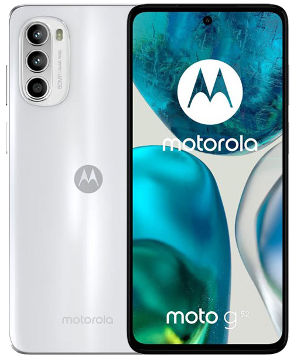

# SushiUI tree for Motorola Moto G52 (rhode)
(for SushiUI Extended)

Configurations for this SushiUIext device written in Makefile and Shell.





Copyright © 2022 Motorola Mobility LLC. All rights reserved.

Copyright (c) 2026 SushiUI / SushiUI Extended. All rights reserved.

---
If you are installing SushiUI on your device,
```Code
* We not responsible for bricked devices, dead SD cards, thermonuclear war, 
* or you getting fired because the alarm app failed. Please do some research 
* if you have any concerns about features included in this module
* before flashing it! YOU are choosing to make these modifications, and if
* you blame us in any way for what happens to your device, we will laugh at you.
* BOOM! goes the dynamite
```

## Building on rhode
```bash
. ./envsetup.sh
smake
```

Build options:
```bash
smake MAINTAINER=name
smake OFFICIAL=1 MAINTAINER=name
smake MAINTAINER="bangkkuser kultrinhaa_"
```

`MAINTAINER` defaults to the output of `whoami`. `OFFICIAL` defaults to `0`.

# Maintainers of this device

[Kultrinhaa](https://github.com/Kultrinhaa) [banned account (will have 404. only used for the first commit/s)](https://github.com/KultrinhaaGihub)

[rebangkkuser (bangkkuser)](https://github.com/rebangkkuser)
